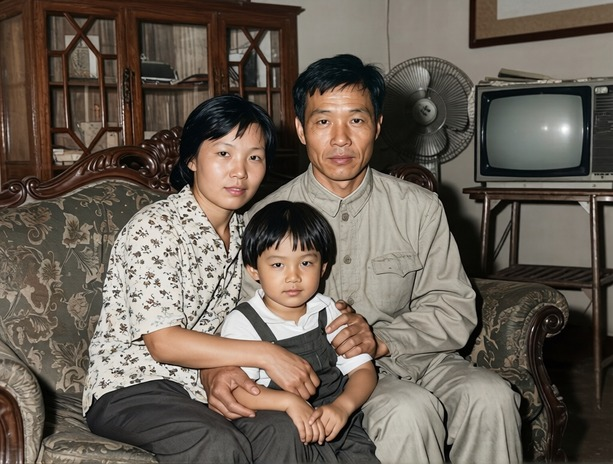
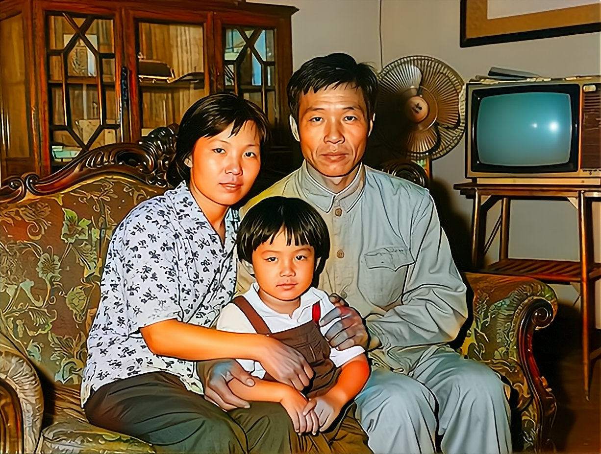
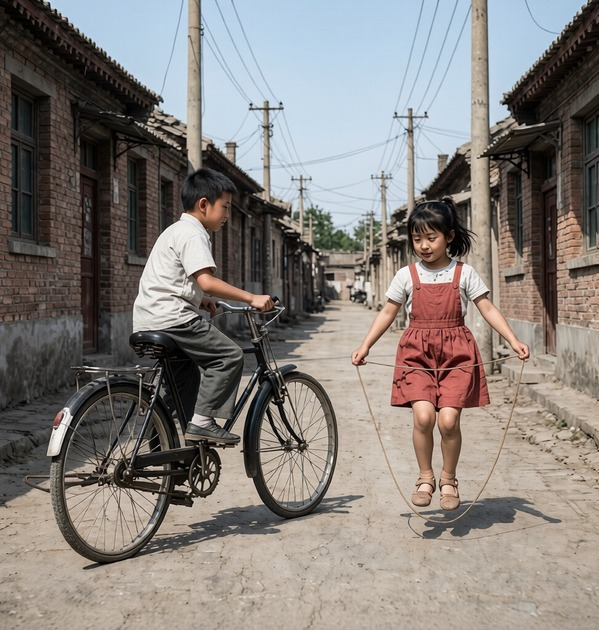
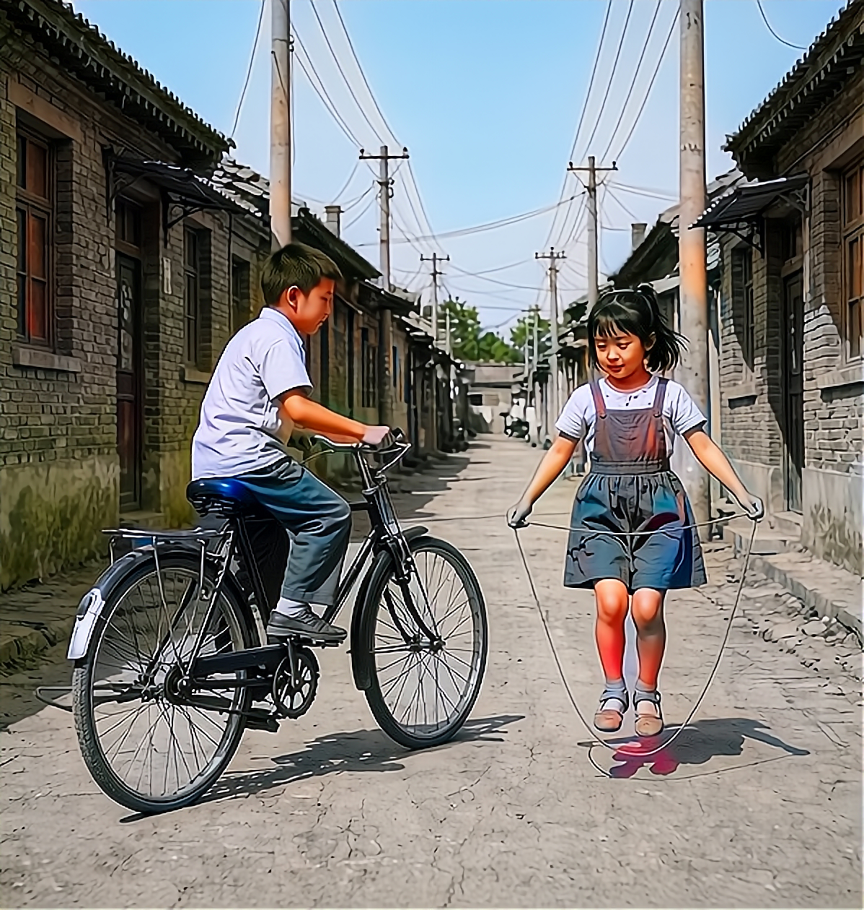
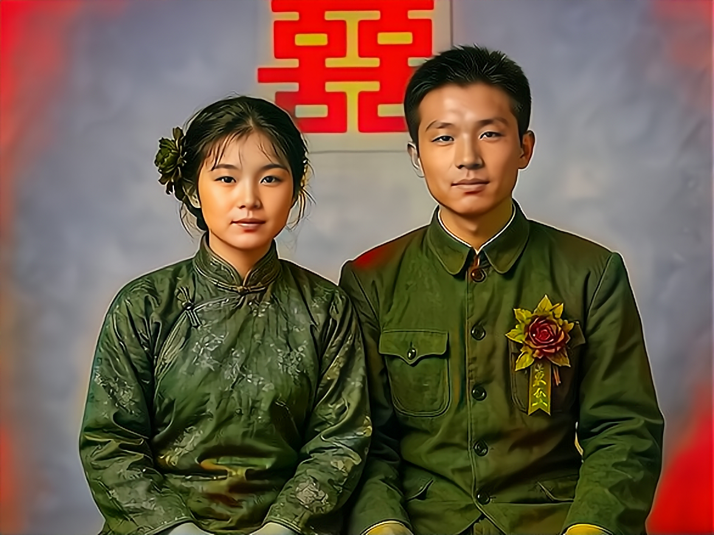

# 拾光 · 家的记忆馆  ·  Shiguang · Home Memory Hall

> 上传一张老照片，AI 帮你修复上色，并把照片背后的故事，做成一本**会说话的家庭纪念册**。

[](./LICENSE)
[](https://www.dumate.cn)
[](https://www.dumate.cn/artifacts/pyutmx3wpox3)

---

## ✨ 这是个什么作品

「拾光·家的记忆馆」是一个面向**家庭记忆留存**的 AI 应用：把泛黄、破损、黑白的老照片，修复成清晰彩色；再围绕照片，用多个 AI 智能体帮你**采集口述故事、自动成稿、生成有声朗读**，最终产出一本可分享的「有声家书 / 纪念册」。

它不是一个单纯的"问答机器人"，而是把 **AI 图像修复 + 口述史访谈 + 有声内容生产** 串成一条流水线——这也是它在比赛里差异化的核心。

### 四位智能体，像一个小工作室

| 智能体 | 角色 | 负责的事 |
| --- | --- | --- |
| **阿拾** | 修复师 | 老照片上色、去折痕、清晰度增强、超分 |
| **小忆** | 访谈员 | 围绕照片发起口述史访谈，引导讲述背后的故事 |
| **文叔叔** | 编导 | 把零散口述整理成有温度的纪念册文稿 |
| **声声** | 朗读者 | 把文稿合成温暖男声，做成可播放的有声内容 |

---

## 🖼️ 效果展示

老照片修复（黑白 / 破损 → 清晰彩色）：

<p align="center">
  
  
</p>
<p align="center"><sub>左：原始老照片（一家三口合影）　右：AI 修复上色后</sub></p>

更多示例：

<p align="center">
  
  
  
</p>

> 完整交互界面、语音访谈、有声家书播放，请直接体验 👉 **[在线演示](https://www.dumate.cn/artifacts/pyutmx3wpox3)**

---

## 🚀 在线演示

👉 **https://www.dumate.cn/artifacts/pyutmx3wpox3**

（部署在百度 DuMate 平台，手机 / 电脑均可打开。注：移动端浏览器出于安全限制不开放麦克风，语音访谈请在桌面端体验。）

---

## 🏗️ 技术架构

```
┌─────────────────────────────────────────────┐
│  前端：百度 DuMate 多智能体编排（阿拾/小忆/    │
│        文叔叔/声声）                          │
│  - 老照片上传、故事卡生成、分享册、有声播放     │
└───────────────┬─────────────────────────────┘
                │  HTTPS（text/plain，规避预检）
┌───────────────▼─────────────────────────────┐
│  后端代理：百度智能云 CFC 云函数（src/）        │
│  - /restore：调用百度图像修复 API（上色/增强/超分）│
│  - /chat   ：调用千帆大模型对话（小忆访谈/文叔叔成稿）│
│  - 密钥仅存服务端环境变量，前端拿不到            │
└─────────────────────────────────────────────┘
```

- **前端**：在 [百度 DuMate](https://www.dumate.cn) 上以可视化方式搭建，多智能体协作即"AI 原生结构"，无需从零训练模型。
- **图像修复**：百度智能云图像增强系列接口（黑白上色 → 色彩增强 → 清晰度增强 → 2× 超分）。
- **对话 / 成稿**：百度千帆大模型（ERNIE 系列）。
- **语音合成**：浏览器 TTS（桌面端）+ 可选服务端 TTS，统一为温暖男声。

---

## 📦 本地运行 / 部署

### 1. 部署后端代理（CFC 云函数）

`src/cfc-index-with-chat.js` 是同时包含「修复 + 访谈」的代理，部署到百度智能云 CFC：

1. 新建 **Node.js 18+** 空白函数（事件函数）。
2. 整文件覆盖为 `src/cfc-index-with-chat.js`，保存。
3. 配置 **HTTP 触发器**（POST，不验证）。
4. 在函数环境变量中填入你自己的密钥（**不要写死在代码里**）：
   - `BAIDU_API_KEY`
   - `BAIDU_SECRET_KEY`
   - `QIANFAN_API_KEY`（千帆控制台创建，以 `bce-v3/` 开头）
5. 把触发器的 URL 填回前端对应的接口地址即可。

> 仅图像修复、不需要访谈的轻量版本见 `src/cfc-index.js`。

### 2. 本地预览（可选）

```bash
cp config.example.json config.json   # 在 config.json 填入你的百度密钥
node src/server.js                    # 启动本地静态服务，默认 http://localhost:8787
```

### 3. 生成示例修复图（可选）

```bash
BAIDU_API_KEY=你的key BAIDU_SECRET_KEY=你的key node src/gen-after-local.js
```

---

## 📂 项目结构

```
.
├── README.md                  # 本文件
├── LICENSE                    # MIT 开源协议
├── config.example.json        # 本地配置模板（复制为 config.json 后填密钥）
├── src/                       # 可复用源码
│   ├── cfc-index-with-chat.js  # CFC 代理：修复 + 千帆访谈双路由
│   ├── cfc-index.js           # CFC 代理：仅图像修复（轻量版）
│   ├── gen-after-local.js      # 本地批量生成修复后示例图
│   └── server.js              # 本地静态预览服务
└── assets/showcase/           # 效果展示用「修复前/后」对比图
```

> 在线演示所使用的 DuMate 应用本体由平台托管，本仓库提供其**后端代理源码**与**效果素材**，方便你理解实现、自行部署同类应用。

---

## 📄 开源协议

本项目以 **MIT 协议** 开源，可自由学习、二次创作、商用，请保留版权声明。详见 [LICENSE](./LICENSE)。

---

## 💡 关于 / 致谢

- 作品参赛：**全国大学生 AI 应用生成大赛**。
- 能力底座：感谢 [百度 DuMate](https://www.dumate.cn) 与百度智能云（图像修复 / 千帆大模型）提供的平台与 API。
- 欢迎 Star ⭐ / Fork，也欢迎基于本项目做出你自己的"家的记忆馆"。
